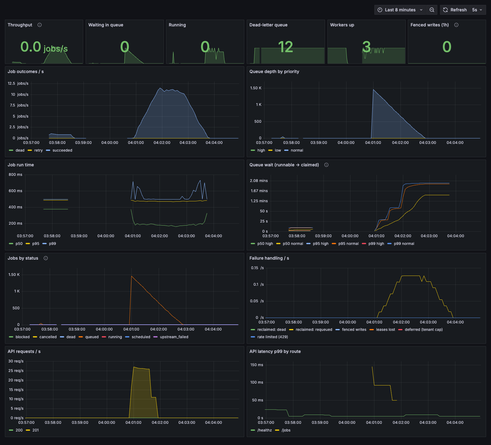

# Distributed-Job-Orchestration-System

[](https://github.com/anubhav-kayal/Distributed-Job-Orchestration-System/actions/workflows/ci.yml)

A distributed, fault-tolerant job orchestrator. Clients submit jobs, DAG workflows and cron schedules; independent workers run them with **exactly-once effects**, even when workers crash, freeze mid-job, or Redis loses all of its data. Python 3.12 · FastAPI · PostgreSQL · Redis · Prometheus · Grafana · Docker Compose.


<sub>The provisioned Grafana dashboard during a chaos run: 1,500 jobs with a worker SIGKILLed every 6 s. 0 lost, 0 duplicated effects.</sub>

## Highlights

- **Exactly-once effects under failure:** leases with heartbeats, a monitor that reclaims orphaned jobs, and **fencing tokens** that reject a stalled worker's late write. A chaos suite (worker SIGKILLs, `docker pause` past the lease, control-plane restarts, **Redis SIGKILLed with all queues and leases lost**) checks the invariants from Postgres after every run.
- **Orchestration features:** priorities with weighted fairness, retries with exponential backoff and full jitter, a dead-letter queue with retry, delayed jobs, cron with any number of schedulers, and **DAG workflows** with failure propagation and resume-from-failure.
- **Multi-tenant:** API keys (hashed), per-tenant isolation, token-bucket rate limits (`429` + `Retry-After`) and concurrency caps against noisy neighbors.
- **Operable:** RED metrics and coordination metrics in Prometheus, a generated Grafana dashboard, 4 alert rules, JSON logs carrying `job_id` / `lease_token`, a backlog-driven **autoscaler** (2 → 8 → 2 workers, HPA-style hysteresis), and graceful drain.
- **Measured:** ~620 jobs/s of pure coordination overhead at 4 workers, linear scaling for real work, 71 ms p99 end-to-end at 20 jobs/s, and ≈4.2 s recovery from a SIGKILL (4 s lease). Plus a **Redis vs Postgres `SKIP LOCKED`** queue comparison ([benchmarks](docs/benchmarks/README.md)).
- **Tested:** 285 tests (unit and integration against real Postgres and Redis) in CI, and every claim above reproducible with one `make` target.

## The problem

Background job systems are easy until a worker dies mid-task. Naive designs either **lose the job** (nobody notices the worker died) or **run it twice** (a slow-but-alive worker is mistaken for a dead one, and another worker re-runs it). Exactly-once *execution* is impossible: a worker can freeze (GC pause, frozen VM, network partition), lose its lease, and wake up still believing it owns the job. So the guarantee here is:

> **At-least-once execution + fencing tokens = exactly-once effects.**

## Architecture

```
                         ┌──────────── Prometheus ──► Grafana (dashboard, alerts)
                         │ scrapes every process (workers found via Compose DNS)
Client ─► API ───────────┤
 (API key, rate limit)   │  commit, then push ID          BLMPOP (weighted priority)
           │             └─────────────► Redis q:high/normal/low ─────────► Workers ×N ◄─ Autoscaler
           │                             lease:{job_id} (SET NX PX, heartbeats) ◄──┤   (backlog → replicas)
           ▼        claim: SELECT … FOR UPDATE, lease_token += 1                   │
       Postgres  ◄────────────────────────────────────────────────────────────────┘
  (source of truth)  finish: only if lease_token still matches (fenced) + effect row
           ▲         + unblock workflow children in the same transaction
           │
     Monitor:   running + no lease → requeue / dead;   queued + missing from Redis → re-push
     Scheduler: scheduled + due → queued (retries, delayed jobs);   cron due → job + next fire
```

**Postgres is the source of truth; Redis is disposable.** Redis only carries job IDs and leases, so anything it loses is rebuilt from Postgres. The chaos suite proves this by SIGKILLing Redis mid-run. A Postgres-only mode (`DJOS_QUEUE_BACKEND=postgres`) makes the jobs table itself the queue (`SELECT … FOR UPDATE SKIP LOCKED`).

## Core guarantees

| Mechanism | What it prevents |
|---|---|
| **Idempotent submission** (`Idempotency-Key`, `INSERT … ON CONFLICT`, per tenant) | a retried request creating a second job |
| **Commit-then-enqueue**, Postgres as source of truth | a worker popping a job that doesn't exist yet; IDs lost between commit and push (re-pushed by the monitor) |
| **Claim through Postgres** (`SELECT … FOR UPDATE`, only if `queued`) | duplicate or stale queue entries running a job twice |
| **Leases** (`SET NX PX`, Lua compare-and-renew/release) | two live workers owning one job; a dead worker holding it forever |
| **Heartbeats** (renew every TTL/3; abandon the job on lease loss) | a long job being mistaken for a dead one |
| **Monitor** (orphan reclaim, stranded re-enqueue) | jobs lost to crashes, failed pushes or a Redis wipe |
| **Fencing tokens** (`lease_token` bumped per claim, fenced final write) | a stalled worker overwriting a re-run's result |
| **Retries** (exponential backoff, full jitter; `PermanentError` skips them) + **dead-letter queue** | transient failures being terminal; retry storms; failed jobs vanishing or looping forever |
| **Weighted priority rotation** (6/3/1 by default) | low priority starving under a flood of high |
| **Cron firing** (`SKIP LOCKED`, job + `next_fire_at` in one transaction, `cron:{id}:{time}` key, DB clock) | duplicate or lost runs with several schedulers |
| **Workflow unblocking** inside the fenced finish, readiness recounted under ordered row locks | a child starting before its parents, or being started twice |
| **Failure propagation** (dead/cancelled → descendants `upstream_failed`; DLQ retry revives them) | half-run workflows stuck forever |
| **Tenant isolation** (hashed API keys, every query scoped) + **token-bucket rate limit** + **concurrency cap** | one tenant reading another's jobs, or starving everyone else |
| **Graceful drain** (SIGTERM: finish the current job, take no more) | a scale-down or deploy interrupting work |

### How a job runs

1. **Submit:** the API authenticates the tenant, spends a rate-limit token, validates the payload against the job type's schema, inserts the job (`queued`, or `scheduled` if it's for later), commits, and *then* pushes its ID onto the priority's Redis list.
2. **Lease:** a worker pops an ID (`BLMPOP`, preferring tiers in a 6/3/1 rotation) and takes `lease:{job_id}` with `SET NX PX`.
3. **Claim:** under `SELECT … FOR UPDATE`, the worker moves the job `queued → running`, bumping `attempts` and the fencing token `lease_token`. A duplicate ID, a cancelled job or a tenant over its concurrency cap is skipped or deferred.
4. **Run + heartbeat:** the handler runs while a heartbeat renews the lease. If the lease is lost, the worker abandons the job.
5. **Finish (fenced):** the outcome is written **only if the job is still `running` with the worker's token**. On success, the effect row is written and workflow children are unblocked, all in that transaction. A failure with attempts left becomes `scheduled` with a jittered backoff; otherwise the job is `dead` (the DLQ).
6. **Monitor:** a `running` job with no lease lost its worker, so it's requeued (or marked dead once out of attempts). A `queued` job missing from Redis is re-pushed.
7. **Scheduler:** promotes due `scheduled` jobs and fires due cron schedules, with `FOR UPDATE SKIP LOCKED` and the database clock, so any number of replicas can run.

## Proof

Each claim is reproducible with one command against the Docker Compose stack:

| Scenario | Command | Result |
|---|---|---|
| **Chaos suite:** 1,740 jobs incl. 60 workflows; worker SIGKILLs, freezes past the lease, control-plane restarts, Redis SIGKILLed twice | `make chaos` | **PASS**: every job settled; exactly 1 effect per success, carrying its final claim's token; only the 91 deliberately broken jobs died; only their 15 dependent workflow jobs became `upstream_failed`; no dependency order violated |
| Chaos suite on the **Postgres queue backend** | `DJOS_QUEUE_BACKEND=postgres make chaos` | **PASS** (920 jobs, 6 kills, 2 freezes, 1 Redis kill) |
| 1,000 jobs on 3 workers | `make verify` | every job `attempts=1`, **exactly 1 effect each** |
| SIGKILL the worker running a job | `make demo-crash` | monitor reclaims it after the lease TTL; another worker finishes it |
| Freeze a worker just before its job finishes, let the job be re-run, unfreeze | `make demo-pause` | woken worker's write rejected: `fenced: our token 1 … is stale (job is succeeded with token 2)` |
| Burst of 1,500 jobs with the autoscaler running | `./scripts/demo_autoscale.sh` | 2 → **8 workers** immediately, back to 2 after the window; all 1,500 with `attempts=1` (no scale-down interrupted a job) |
| Every-minute cron with **2 scheduler replicas** | `make verify-cron` | exactly one job per minute, fires split between replicas, 0 duplicates |
| Noisy tenant (max 1 running) floods 30 jobs, then a quiet tenant submits 5 | `make demo-tenants` | quiet tenant done in 2 s (≈5 s behind the flood without the cap); 50-request burst on a 40-token bucket: 17 accepted, 33 × `429` |
| Diamond ETL workflow; then with one branch broken | Workflows API | branches ran in parallel and the join waited for the slower one; with a branch dead, its sibling still ran and the join became `upstream_failed` |
| No workers running | scale workers to 0 | `NoWorkers` alert: pending → firing after its 1-minute hold |

## Benchmarks

| | Redis queue | Postgres `SKIP LOCKED` queue |
|---|---|---|
| Coordination throughput, 0 ms jobs, 4 workers | 622 jobs/s | 618 jobs/s |
| 50 ms jobs, 1 → 8 workers | 14.8 → 119.7 jobs/s (linear) | 14.4 → 116.9 jobs/s (linear) |
| End-to-end latency at 20 jobs/s (p50 / p99) | 64 / 71 ms | 81 / 123 ms |
| SIGKILL → job running again (4 s lease) | 4.2 s median | 4.2 s median |

Both backends hit the same ceiling, **Postgres commits** (two per job, the price of fenced exactly-once effects). Redis wins on latency because `BLMPOP` blocks while Postgres has to poll. Full results, the method (pre-loaded drain, open-loop load, warm-up) and analysis, including a super-linear result traced to WAL group commit, are in [docs/benchmarks](docs/benchmarks/README.md).

## Observability

`make up` starts **Prometheus** (http://localhost:59090) and **Grafana** (http://localhost:53000, dashboard provisioned, anonymous read-only).

- **Metrics:** submissions; outcomes (`succeeded` / `retry` / `dead`); job run time and queue wait histograms; HTTP rate and latency by route template; reclaims, fenced writes, lost leases, tenant deferrals and rate-limit rejections; queue depth and jobs per status. No `tenant` or `job_id` labels, to keep cardinality bounded.
- **Alerts** ([`alerts.yml`](deploy/prometheus/alerts.yml)): `DeadLetterQueueGrowing`, `QueueBacklogHigh`, `NoWorkers`, and `FencedWritesSeen`. That last one means correctness held but something is pausing workers past their lease.
- **Logs:** one JSON object per line. Everything logged while a job runs carries `job_id`, `tenant_id`, `worker_id` and `lease_token`.
- The dashboard is generated by [`build_dashboard.py`](deploy/grafana/build_dashboard.py), and [`check_dashboard.py`](scripts/check_dashboard.py) runs every panel's query against Prometheus.

## Getting started

Requires Docker (or OrbStack) and [uv](https://docs.astral.sh/uv/).

```bash
make up              # API, 3 workers, monitor, scheduler, Postgres, Redis, Prometheus, Grafana
make test            # 285 tests (needs Postgres + Redis: make up, or docker compose up -d postgres redis)
make lint

make chaos           # chaos suite + invariant checker (~2 minutes)
make demo-crash      # SIGKILL a worker mid-job
make demo-pause      # freeze a worker; its stale write is fenced
make demo-tenants    # noisy vs quiet tenant, rate limiting
make verify-cron     # every-minute cron with 2 schedulers (~3.5 minutes)
make autoscale       # run the autoscaler (on the host)
make bench           # benchmarks → docs/benchmarks (BACKEND=redis|postgres)
```

The API is at http://localhost:58000 (OpenAPI docs at `/docs`). Host ports default to `58000` (API), `55432` (Postgres), `56379` (Redis), `59090` (Prometheus) and `53000` (Grafana) to avoid clashing with local services. All settings are environment variables prefixed `DJOS_` (see [`core/config.py`](src/djos/core/config.py)).

### Project layout

```
src/djos/
  api/          FastAPI routes (jobs, workflows, schedules, DLQ, admin), auth, rate limiting, /metrics
  jobs/         state machine, submission service, retry policy, schemas
  worker/       claim → run with heartbeat → fenced finish; both queue backends
  coordination/ Redis leases (SET NX PX + Lua)
  queue/        Redis lists (BLMPOP) and Postgres SKIP LOCKED backends, priority fairness
  monitor/      orphan reclaim, stranded re-enqueue, gauges
  scheduler/    due-job promotion, cron firing
  workflows/    DAG validation (Kahn), engine (unblock / fail / revive), API service
  cron/ tenancy/ autoscaler/ handlers/ models/ core/
migrations/     Alembic (hand-written data and CHECK-constraint migrations where needed)
chaos/          fault injection + invariant checker
bench/          benchmark harness + report generator
deploy/         Prometheus config and alerts, Grafana provisioning and dashboard generator
scripts/        demos and verification scripts
docs/           notes for each week, benchmarks, screenshots
```

### Jobs API

```bash
# Submit (201). Retrying with the same Idempotency-Key returns the same job (200,
# Idempotent-Replayed: true); reusing the key with a different body is a 422.
curl -X POST localhost:58000/jobs \
  -H 'Content-Type: application/json' -H 'Idempotency-Key: order-42' \
  -d '{"type": "sleep", "payload": {"seconds": 2}, "priority": "high"}'

curl localhost:58000/jobs/<id>                       # fetch one (status, attempts, lease_token, locked_by, result…)
curl 'localhost:58000/jobs?status=queued&limit=20'   # list / filter / paginate
curl -X POST localhost:58000/jobs -H 'Content-Type: application/json' \
  -d '{"type": "sleep", "delay_seconds": 300}'      # run in 5 minutes (or "run_at": "<ISO time with tz>")
curl -X POST localhost:58000/jobs/<id>/cancel        # only while queued or scheduled, else 409
curl localhost:58000/healthz                         # liveness
curl localhost:58000/readyz                          # readiness (checks Postgres + Redis)
```

Job types (each with a validated payload schema, see [`handlers/builtin.py`](src/djos/handlers/builtin.py)):

| Type | Payload | What it simulates |
|---|---|---|
| `sleep` | `{"seconds": 1.0}` | I/O-bound work |
| `hash` | `{"data": "...", "iterations": 100000}` | CPU-bound work (runs in a thread) |
| `fake_email` | `{"to": "a@b.co", "subject": "..."}` | an external API call |
| `flaky` | `{"fail_times": 1}` | fails on its first N attempts |
| `fail` | `{"message": "...", "permanent": false}` | always fails (permanently: no retries) |

A handler signals "retrying won't help" by raising `PermanentError`. Any other exception is retried with backoff until `max_attempts` is used up.

### Dead-letter queue

```bash
curl 'localhost:58000/dlq?type=fail'                 # dead jobs, newest first
curl -X POST localhost:58000/dlq/<id>/retry          # re-queue with a fresh set of attempts
```

### Workflows (DAGs)

```bash
curl -X POST localhost:58000/workflows -H 'Content-Type: application/json' -d '{
  "name": "etl",
  "jobs": [
    {"key": "extract", "type": "sleep", "payload": {"seconds": 1}},
    {"key": "clean",   "type": "sleep", "payload": {"seconds": 1}, "depends_on": ["extract"]},
    {"key": "enrich",  "type": "sleep", "payload": {"seconds": 1}, "depends_on": ["extract"]},
    {"key": "load",    "type": "sleep", "payload": {"seconds": 1}, "depends_on": ["clean", "enrich"]}
  ]}'

curl localhost:58000/workflows/<id>                  # status (derived) + every job with its dependencies
curl -X POST localhost:58000/workflows/<id>/cancel   # cancel everything not yet running
```

The graph is validated on submit (cycles, unknown or duplicate keys, payloads), and all jobs are created in one transaction. A job becomes `queued` when every dependency has succeeded. If a dependency dies or is cancelled, the job becomes `upstream_failed` without running. Retrying the failed job from the DLQ revives those descendants, so the workflow resumes from where it failed. A workflow's status (`running`, `succeeded`, `failed` or `cancelled`) is computed from its jobs when you read it.

### Tenants, API keys and limits

```bash
export DJOS_ADMIN_TOKEN=some-long-admin-token-123   # enables the admin API (off by default)
docker compose up -d

curl -X POST localhost:58000/admin/tenants -H "Authorization: Bearer $DJOS_ADMIN_TOKEN" \
  -H 'Content-Type: application/json' \
  -d '{"name": "acme", "rate_limit_per_second": 10, "burst": 50, "max_concurrency": 5}'
# → {..., "api_key": "djos_…"}   shown once; only its SHA-256 hash is stored

curl localhost:58000/jobs -H 'Authorization: Bearer djos_…'   # acme's jobs only
```

Every job, workflow, schedule and DLQ entry belongs to a tenant, and tenants can only see their own (another tenant's job is a `404`). Idempotency keys and schedule names are unique per tenant. Submissions spend tokens from the tenant's bucket (`429` + `Retry-After` when empty; a workflow costs one token per job). `max_concurrency` caps the tenant's running jobs across all workers: a job over the cap is deferred for a moment instead of run. Requests without a key use a built-in `default` tenant unless `DJOS_REQUIRE_API_KEY=true`, which you should set in production. Admin endpoints: `POST /admin/tenants`, `GET /admin/tenants`, `PUT /admin/tenants/{id}/limits`, `POST /admin/tenants/{id}/rotate-key`.

### Cron schedules

```bash
curl -X POST localhost:58000/schedules -H 'Content-Type: application/json' -d '{
  "name": "nightly-digest", "cron": "0 2 * * *",
  "job": {"type": "fake_email", "payload": {"to": "team@example.com", "subject": "digest"}}}'

curl localhost:58000/schedules                                        # list
curl -X PATCH localhost:58000/schedules/<id> -d '{"enabled": false}' \
  -H 'Content-Type: application/json'                                 # pause (or change cron / job)
curl -X DELETE localhost:58000/schedules/<id>
```

Cron expressions are 5-field and evaluated in UTC. If the scheduler was down across several fire times, the schedule fires **once** on recovery and skips ahead rather than replaying every missed run.

Job lifecycle (enforced in [`jobs/states.py`](src/djos/jobs/states.py)):

```
scheduled ──► queued ──► running ──► succeeded
    │  ▲          │ ▲        │  └────► dead        (out of attempts / permanent error)
    │  │          │ │        ├───────► queued      (lease expired: reclaimed)
    │  └──────────┼─┼────────┘                     (failed, attempts left: retry later)
    │             │ └─────────────── dead          (manual retry from the DLQ)
    └─────────────┴──────────────────► cancelled

blocked ──► queued                         (workflow job: all dependencies succeeded)
   │ ▲
   ▼ │                                     (a dependency died or was cancelled /
upstream_failed                             that dependency was retried from the DLQ)
```

## Known limitations

- **Redis is a single point of failure for coordination.** A production system would use Redis Sentinel/Cluster or a consensus-based coordinator like etcd. Because Postgres is the source of truth, a Redis loss delays jobs but doesn't lose them.
- **Fencing protects writes this system controls.** It covers the job's status and its effect row. A handler calling an external service (payments, email) should also pass `job_id` as that service's idempotency key, because the stale run may already have made the call.
- **The stranded-job check uses `LPOS`**, a linear scan of the queue, bounded per sweep. A very large backlog would want a reliable-queue pattern (`BLMOVE` into per-worker processing lists) instead.
- **Each worker runs one job at a time.** You scale by adding workers (or let the autoscaler do it).
- **Postgres is the throughput ceiling.** Every job costs two committing transactions for fenced exactly-once effects. Batching claims, or relaxing durability, would trade guarantees for speed.
- **The autoscaler drives Docker Compose from the host.** On Kubernetes the same policy maps onto KEDA (Redis list-length trigger) plus HPA scale-down behaviour.
- **Tenant fairness is a cap, not a fair-share scheduler.** All tenants share one queue per priority. `max_concurrency` stops one tenant from occupying every worker, but over-cap jobs are deferred and re-checked rather than ordered by weighted fair queuing.
- **Rate limiting fails open.** If Redis is unreachable, submissions are allowed rather than refused: availability is chosen over strict limiting.

## Notes

How it was built, week by week, with the reasoning behind each decision and the bugs found along the way: [week 1](docs/notes/week-1.md) · [week 2](docs/notes/week-2.md) · [week 3](docs/notes/week-3.md) · [the original plan](PLAN.md)

## License

MIT
