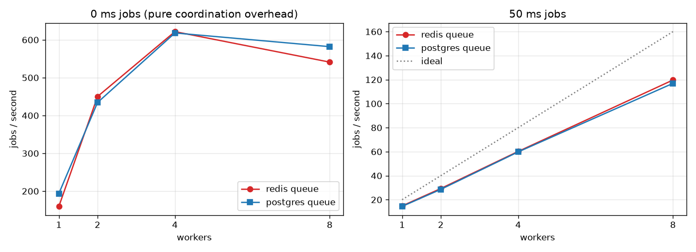

# Benchmarks

Generated by `uv run python -m bench.report` from the result files written by
`make bench BACKEND=redis` and `make bench BACKEND=postgres`. Everything runs on one
laptop (OrbStack containers sharing the CPU with Postgres and Redis), so absolute
numbers are modest; the *shapes* and the comparison are the point.

## Throughput (pre-loaded backlog, drained by N workers)

| job | workers | redis jobs/s | postgres jobs/s |
|---|---|---|---|
| 0 ms | 1 | 159.7 | 193.7 |
| 0 ms | 2 | 450.2 | 434.4 |
| 0 ms | 4 | 621.7 | 618.2 |
| 0 ms | 8 | 541.1 | 582.0 |
| 50 ms | 1 | 14.8 | 14.4 |
| 50 ms | 2 | 29.3 | 28.6 |
| 50 ms | 4 | 60.2 | 59.8 |
| 50 ms | 8 | 119.7 | 116.9 |

## Latency under steady load (open-loop submitter, 4 workers, 50 ms jobs)

| rate | backend | end-to-end p50 / p95 / p99 (ms) | queue wait p50 / p95 / p99 (ms) |
|---|---|---|---|
| 20/s | redis | 63.8 / 67.8 / 70.6 | 7.6 / 9.2 / 12.1 |
| 20/s | postgres | 81.2 / 114.2 / 122.9 | 22.5 / 55.7 / 63.3 |
| 60/s | redis | 59.3 / 89.8 / 118.7 | 4.4 / 33.2 / 61.5 |
| 60/s | postgres | 86.6 / 113.3 / 140.3 | 31.3 / 56.2 / 84.7 |

## Recovery (SIGKILL the worker running a job → another worker runs it)

- **redis**: median 4.2 s, max 4.55 s over 5 kills (lease TTL 4 s)
- **postgres**: median 4.22 s, max 5.06 s over 5 kills (lease TTL 4 s)

## What the numbers say

1. **The queue isn't the bottleneck; Postgres is.** Both backends drain at almost the
   same rate, peak around 620 jobs/s with 4 workers on zero-work jobs, and fall off at 8.
   Every job costs two committing transactions (claim; fenced finish + effect) plus row
   locks on the source of truth. That's the price of the exactly-once-effects design,
   and it's the same whichever queue hands out the IDs.
2. **The jump from 1 to 2 workers looks super-linear because of the WAL flush.** One
   worker waits for every commit's disk flush in turn; concurrent workers' commits are
   flushed together (group commit). Confirmed by experiment: with
   `synchronous_commit = off`, one worker went from 201 to 607 jobs/s and 1 → 2 workers
   became ordinary sub-linear scaling (1.76×). (The setting was restored; durability
   isn't traded for a benchmark.)
3. **Real work scales linearly.** With 50 ms jobs, throughput doubles with each doubling
   of workers (14.8 → 29.3 → 60.2 → 119.7 jobs/s), about 75% of the ideal because each
   job also pays the coordination overhead.
4. **Redis wins on latency.** A blocking pop (`BLMPOP`) wakes the instant a job arrives;
   the Postgres backend has no blocking pop and polls with backoff, which shows up as
   queue wait: p50 7.6 vs 22.5 ms at 20 jobs/s. LISTEN/NOTIFY would let Postgres wake
   workers too.
5. **Recovery is the same** (≈ lease TTL + one monitor sweep): it's driven by leases,
   not by the queue.

**Verdict:** for this design a Postgres-only queue matches Redis on throughput and
removes a dual write (no ID to lose between commit and push), at the cost of ~15–25 ms
more queue wait. Redis earns its place for latency-sensitive work. Since leases still
live in Redis, going Postgres-only would also need leases in Postgres (or advisory
locks) before Redis could be dropped entirely.
